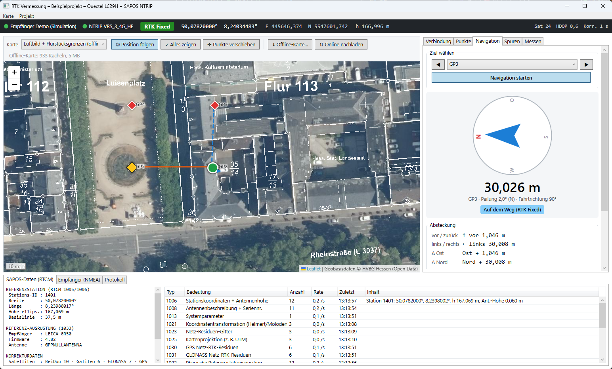
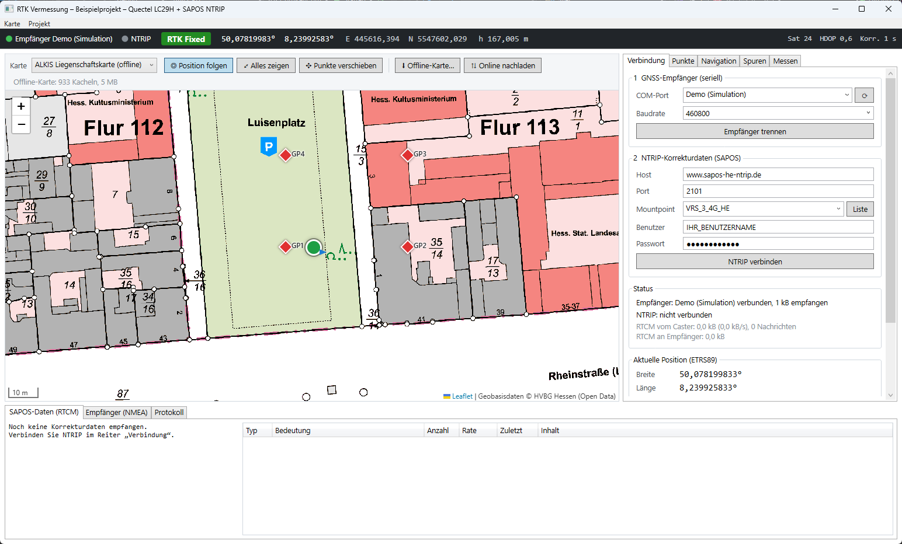
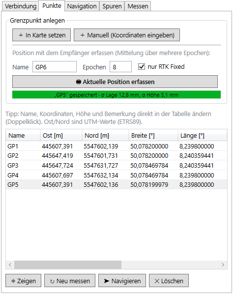
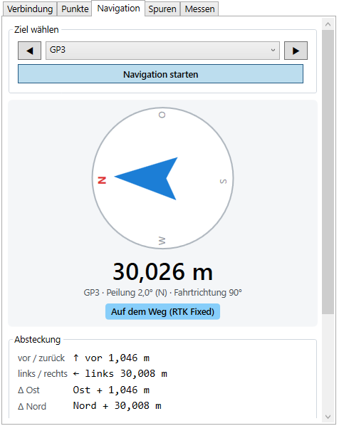
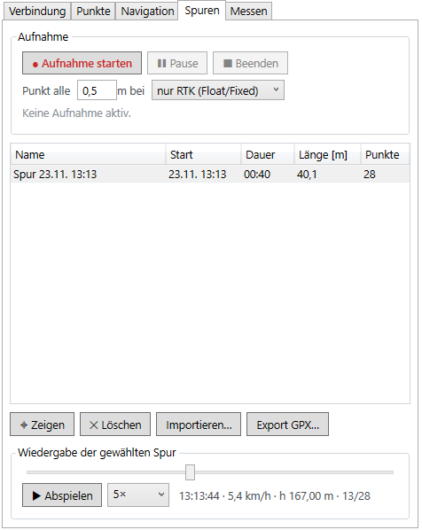
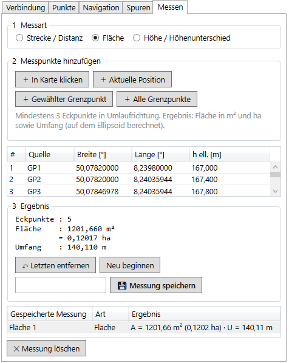
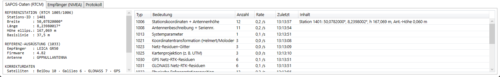
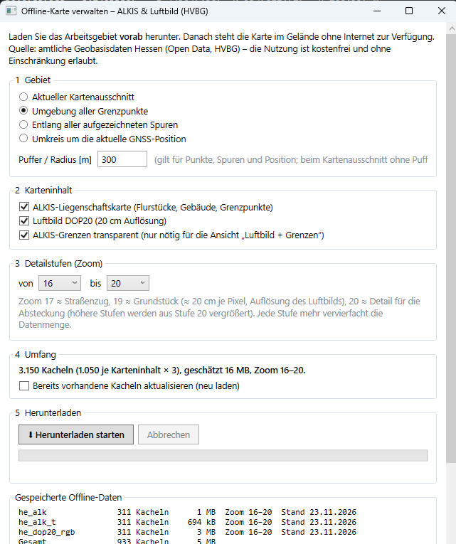

# RTK Vermessung für Hessen

Ein Windows-Programm, mit dem du mit einem **RTK-GNSS-Modul** und den **SAPOS-Korrekturdaten aus Hessen** zentimetergenau Punkte erfassen, anlaufen (abstecken), aufzeichnen und ausmessen kannst – mit einer **Karte, die auch ohne Internet funktioniert** (amtliche ALKIS-Liegenschaftskarte und Luftbild der HVBG).



> **Wichtig vorweg:** Das Programm ist ein Werkzeug für eigene Messungen und kein Ersatz für eine amtliche Vermessung. Mehr dazu im Abschnitt [Genauigkeit und Grenzen](#genauigkeit-und-grenzen).

---

## Inhalt

- [Was kann das Programm?](#was-kann-das-programm)
- [Was brauchst du dafür?](#was-brauchst-du-dafür)
- [Schnellstart](#schnellstart)
- [Einrichtung Schritt für Schritt](#einrichtung-schritt-für-schritt)
- [Bedienung](#bedienung)
- [Offline-Karte](#offline-karte)
- [Das Konsolenprogramm](#das-konsolenprogramm)
- [Einstellungen](#einstellungen)
- [Wo liegen meine Daten?](#wo-liegen-meine-daten)
- [Genauigkeit und Grenzen](#genauigkeit-und-grenzen)
- [Wie funktioniert RTK? (kurz erklärt)](#wie-funktioniert-rtk-kurz-erklärt)
- [Fehlersuche](#fehlersuche)
- [Projektaufbau](#projektaufbau)
- [Datenquellen, Lizenzen, Haftung](#datenquellen-lizenzen-haftung)

---

## Was kann das Programm?

| Bereich | Das kannst du tun |
|---|---|
| **Position** | Aktuelle Position live auf der Karte sehen, mit Fix-Status (RTK Fixed / Float), Satelliten, HDOP und Genauigkeit |
| **Korrekturdaten** | Mit SAPOS Hessen verbinden (NTRIP). Alle empfangenen Daten werden im Programm angezeigt |
| **Grenzpunkte** | Punkte in der Karte setzen, mit dem Empfänger einmessen (Mittelung über viele Messungen), per Hand eingeben oder importieren. Name, Koordinaten und Höhe lassen sich jederzeit ändern – auch per Ziehen in der Karte |
| **Navigation** | Zu einem Punkt hinlaufen: Richtungspfeil, Entfernung in Zentimetern, „3 cm nach links, 1,20 m vor“ – ideal zum Abstecken |
| **Spuren** | Wege aufzeichnen, speichern, wieder laden und abspielen; Export als GPX |
| **Messen** | Strecken, Flächen, Höhen und Höhenunterschiede messen und speichern |
| **Karte offline** | ALKIS-Liegenschaftskarte und Luftbild (20 cm) vorab herunterladen und im Gelände ohne Internet nutzen |
| **Ohne Hardware testen** | Eingebauter Demo-Modus, der einen Empfänger simuliert |

---

## Was brauchst du dafür?

- **Windows 10 oder 11**
- **.NET 8 SDK** zum Selbstbauen ([Download](https://dotnet.microsoft.com/download/dotnet/8.0))
- **WebView2-Runtime** für die Karte (bei Windows 11 schon vorhanden, sonst [hier](https://developer.microsoft.com/microsoft-edge/webview2/))
- **Ein RTK-fähiges GNSS-Modul** mit serieller/USB-Schnittstelle. Entwickelt wurde das Programm für ein **Quectel LC29H-DA** mit einer **Waveshare USB-Serial-Bridge**. Andere Module, die NMEA ausgeben und RTCM3 annehmen, sollten ebenfalls funktionieren.
- **Zugangsdaten für SAPOS Hessen** (Benutzername und Passwort). Die bekommst du bei der Hessischen Verwaltung für Bodenmanagement und Geoinformation (HVBG).
- **Internet** – nur für die Korrekturdaten und zum einmaligen Herunterladen der Karte.

> **Zum Teststand:** Die Verbindung zu SAPOS Hessen und der Kartenteil wurden gegen die echten Dienste getestet. Die Anbindung des Empfängers ist nach dem NMEA-Standard umgesetzt und mit dem eingebauten Demo-Modus geprüft. Wenn du es mit echter Hardware ausprobierst, freue ich mich über Rückmeldungen (siehe [Fehlersuche](#fehlersuche)).

---

## Schnellstart

```powershell
git clone https://github.com/HoeferSebastian/rtk-vermessung-hessen.git
cd rtk-vermessung-hessen
dotnet run --project src/Ntrip.Wpf
```

Beim ersten Bauen wird die Datei `src/Ntrip.Wpf/appsettings.json` automatisch aus der Vorlage `appsettings.example.json` angelegt. Trage dort deine SAPOS-Zugangsdaten ein (Benutzername und Passwort) und starte das Programm neu.

**Du hast noch kein Modul?** Wähle im Reiter *Verbindung* beim COM-Port den Eintrag **„Demo (Simulation)“**. Das Programm simuliert dann einen Empfänger (RTK Fixed), der erst 40 Sekunden am Startpunkt steht und dann im Rechteck (40 × 30 m) läuft, an den Ecken kurz stehen bleibend – wie bei einer echten Punktmessung. So kannst du alles ausprobieren, auch das Erfassen, Navigieren und Aufzeichnen.

> Die Zugangsdaten, die du im Programm eintippst, werden **nicht gespeichert**. Dauerhaft gelten nur die Werte aus der `appsettings.json`.

---

## Einrichtung Schritt für Schritt

### 1. Modul anschließen

Stecke die USB-Bridge ein. Im Windows-Gerätemanager unter *Anschlüsse (COM & LPT)* siehst du, welche COM-Nummer sie bekommen hat (z. B. `COM5`).

Das Programm erwartet vom Modul **NMEA-Sätze** (mindestens `GGA`, besser auch `RMC`) und schickt **RTCM3-Korrekturdaten** an das Modul zurück. Beim LC29H-DA ist das ab Werk so eingestellt. Die Standard-Baudrate ist dort **460800**.

### 2. Zugangsdaten eintragen

In `src/Ntrip.Wpf/appsettings.json`:

```json
{
  "Ntrip": {
    "Host": "www.sapos-he-ntrip.de",
    "Port": 2101,
    "Mountpoint": "VRS_3_4G_HE",
    "Username": "DEIN_BENUTZERNAME",
    "Password": "DEIN_PASSWORT"
  }
}
```

Welche Mountpoints es gibt, siehst du im Programm über den Knopf **„Liste“** neben dem Mountpoint-Feld.

### 3. Verbinden

Im Reiter **Verbindung**:

1. COM-Port und Baudrate wählen → **Empfänger verbinden**
2. **NTRIP verbinden**



Oben in der Statuszeile siehst du jetzt, was passiert:

| Anzeige | Bedeutung |
|---|---|
| 🟢 **RTK Fixed** | Beste Qualität: Genauigkeit im Zentimeterbereich |
| 🟠 **RTK Float** | RTK läuft, aber noch nicht „eingerastet“ – Genauigkeit eher Dezimeter. Kurz warten, freie Sicht zum Himmel |
| 🔴 **Autonom / DGPS** | Nur normales GPS, keine Korrekturdaten angekommen – Genauigkeit nur einige Meter |
| ⚪ **Kein Fix** | Noch keine Position |

Der Fix wird dauerhaft angezeigt, damit du immer weißt, wie viel du der Position trauen kannst.

---

## Bedienung

Das Fenster ist dreigeteilt: links die **Karte**, rechts die **Reiter** für die Aufgaben, unten die **Ausgabe** (SAPOS-Daten, NMEA, Protokoll).

### Karte

- **Kartenart** (oben links): ALKIS-Liegenschaftskarte, Luftbild, Luftbild mit Flurstücksgrenzen (alle offline-fähig) sowie OSM, Esri-Luftbild und Topo-Karte (nur online).
- **Position folgen**: Die Karte bleibt auf deiner Position. Verschiebst du die Karte mit der Maus, wird das automatisch ausgeschaltet.
- **Alles zeigen**: Zoomt auf alle Punkte, Spuren und deine Position.
- **Punkte verschieben**: Wenn eingeschaltet, kannst du Grenzpunkte mit der Maus ziehen. Ausgeschaltet kannst du nichts versehentlich verschieben.
- Der **Marker** zeigt deine Position, die Farbe entspricht dem Fix (grün = RTK Fixed). Ein kleiner Pfeil zeigt die Laufrichtung.
- Mit **Esc** beendest du jedes aktive Karten-Werkzeug (z. B. „Punkt setzen“).

### Reiter „Punkte“ – Grenzpunkte verwalten



Es gibt drei Wege, einen Punkt anzulegen:

1. **In Karte setzen** – einschalten und in die Karte klicken. Gut zum Planen.
2. **Aktuelle Position erfassen** – das Programm misst über mehrere Sekunden (Standard: 30 Messungen) und bildet den Mittelwert. Das ist genauer als ein einzelner Messwert. Dazu bekommst du die Streuung (σ) in Millimetern. Mit „nur RTK Fixed“ zählen nur Messungen mit bestem Fix.
3. **Manuell** – legt einen Punkt an, den du in der Tabelle mit eigenen Koordinaten füllst.

In der Tabelle kannst du **alles per Doppelklick ändern**: Name, UTM-Ost/Nord, Breite/Länge, Höhe, Bemerkung. Ändert man Ost/Nord, rechnet das Programm Breite/Länge mit um (und umgekehrt).

Weitere Knöpfe: **Zeigen** (Karte springt zum Punkt), **Neu messen** (ersetzt die Koordinaten durch eine frische Messung), **Navigieren**, **Löschen**.

### Reiter „Navigation“ – zu einem Punkt laufen



1. Ziel in der Liste wählen (mit ◀ ▶ blätterst du durch die Punkte).
2. **Navigation starten**.

Du siehst:

- einen **Pfeil**, der zum Ziel zeigt – entweder bezogen auf deine Laufrichtung („geradeaus = Ziel liegt vor dir“) oder auf Norden,
- die **Entfernung** (unter 1 m in Zentimetern),
- die **Absteckung**: „vor/zurück“ und „links/rechts“ in Metern, dazu Ost-/Nord-/Höhenunterschied,
- eine **grüne Meldung „Punkt erreicht“**, sobald du innerhalb der Toleranz bist (Standard: 3 cm, einstellbar).

Auf der Karte wird eine gestrichelte Linie zum Ziel gezeichnet. Ist der Fix nicht gut (kein RTK), warnt dich das Programm.

> Die Laufrichtung kommt vom Empfänger und steht erst ab etwa 0,5 m/s Bewegung zur Verfügung. Im Stand bleibt die zuletzt bekannte Richtung erhalten.

### Reiter „Spuren“ – Wege aufzeichnen



- **Aufnahme starten** zeichnet deinen Weg auf. Ein neuer Punkt wird gespeichert, sobald du dich mindestens eine einstellbare Strecke (Standard: 0,5 m) bewegt hast. So entstehen keine unnötigen Punkte, wenn du stehst.
- Du kannst festlegen, ab welcher Qualität aufgezeichnet wird (jeder Fix / nur RTK / nur RTK Fixed).
- **Pause** und **Beenden** sind jederzeit möglich.
- Gespeicherte Spuren erscheinen in der Liste (Name per Doppelklick änderbar) und in der Karte.
- Mit dem **Schieberegler** kannst du eine Spur **abspielen** (1×, 5× oder 20×) – die Position wandert über die Karte.
- **Export GPX** / **Importieren** für den Austausch mit anderer Software.

### Reiter „Messen“ – Strecken, Flächen, Höhen



1. **Messart** wählen: *Strecke*, *Fläche* oder *Höhe*.
2. **Messpunkte hinzufügen**: in die Karte klicken, die aktuelle Position nehmen, einen Grenzpunkt nehmen oder gleich alle Grenzpunkte.
3. Das **Ergebnis** erscheint sofort:
   - *Strecke*: Länge entlang der Punkte, Luftlinie, Peilung, bei Höhenangaben auch die 3D-Länge
   - *Fläche*: Fläche in m² und Hektar, Umfang
   - *Höhe*: Höhe jedes Punktes, Höhenunterschiede, Neigung in Prozent und Grad
4. **Messung speichern** – sie bleibt im Projekt und wird in der Karte angezeigt.

> Punkte, die du in die Karte klickst, haben **keine Höhe**. Höhen gibt es nur aus GNSS-Messungen („Aktuelle Position“) oder von Grenzpunkten, die eine Höhe haben. Deshalb ist Karten-Klicken bei der Messart *Höhe* ausgeschaltet.

### Ausgabe unten: SAPOS-Daten



Hier siehst du, was von SAPOS ankommt – nützlich, um zu prüfen, ob die Verbindung wirklich Daten liefert:

- **Links:** Die Referenzstation (Position und Abstand zu dir), deren Empfänger und Antenne, wie viele Satelliten pro System (GPS, GLONASS, Galileo, BeiDou) in den Korrekturen stecken, Datenrate und Zeit der letzten Nachricht.
- **Rechts:** Jede Nachrichtenart mit Nummer, Bedeutung, Anzahl, Häufigkeit und Inhalt (z. B. `1074` = GPS-Beobachtungen, `1006` = Stationskoordinaten).

Der Reiter **Empfänger (NMEA)** zeigt die rohen Sätze vom Modul, **Protokoll** die Meldungen des Programms.

---

## Offline-Karte

Im Gelände hast du oft kein Internet. Damit die Karte trotzdem da ist, lädst du das Arbeitsgebiet **vorher** herunter.



### So gehst du vor

1. Mit Internet: Knopf **„⬇ Offline-Karte…“** über der Karte (oder Menü *Karte*).
2. **Gebiet wählen:** aktueller Kartenausschnitt, Umgebung deiner Grenzpunkte, entlang deiner Spuren oder Umkreis um deine Position. Dazu kommt ein Puffer in Metern.
3. **Karteninhalt wählen:**
   - *ALKIS-Liegenschaftskarte* – Flurstücke, Gebäude, Grenzpunkte
   - *Luftbild DOP20* – Luftbild mit 20 cm Auflösung
   - *ALKIS-Grenzen transparent* – nur nötig für die Ansicht „Luftbild + Flurstücksgrenzen“
4. **Zoomstufen wählen** (Vorschlag: 16 bis 20). Zoom 19 entspricht etwa einem Grundstück, Zoom 20 ist das feinste, was es gibt.
5. Das Programm zeigt dir **Kachelzahl und geschätzte Größe**. Dann **Herunterladen starten**.

Du kannst den Download jederzeit abbrechen; was schon geladen ist, bleibt erhalten. Ein zweiter Durchlauf lädt nur das, was fehlt.

### Im Gelände

Wähle als Kartenart eine der Einträge mit **„(offline)“**. Mit dem Schalter **„Online nachladen“** legst du fest:

- **an:** Fehlende Kacheln werden – sofern Internet da ist – nachgeladen und gespeichert. Mit der Zeit wächst deine Offline-Karte von allein.
- **aus:** Es werden nur gespeicherte Kacheln gezeigt. Wo nichts gespeichert ist, steht „keine Offline-Daten“.

### Wie viel Platz braucht das?

Grobe Faustregel für **ein Quadratkilometer** bei Zoom 16–20 und allen drei Karteninhalten: **etwa 30–50 MB**. Jede zusätzliche Zoomstufe vervierfacht die Datenmenge. Ganz Hessen in hoher Auflösung herunterzuladen ist nicht sinnvoll (viele Millionen Kacheln) – lade nur dein Arbeitsgebiet.

### Geschwindigkeit

Das Programm holt die Kacheln in **Blöcken von 8 × 8 Kacheln** mit je einem Abruf und schneidet sie selbst zu. Das ist deutlich schneller als einzelne Kacheln: gemessen wurden etwa 70 Kacheln pro Sekunde bei einem zusammenhängenden Gebiet. Bei kleinen oder verstreuten Gebieten ist es langsamer.

### Der Kachelspeicher

Alle Kacheln liegen in **einer einzigen Datei** (SQLite): `%LOCALAPPDATA%\NtripRtk\Offline\hessen-kacheln.sqlite`. Du kannst sie kopieren, z. B. auf einen zweiten Rechner. Den Speicherort änderst du in der `appsettings.json` (siehe [Einstellungen](#einstellungen)). Im Dialog siehst du, was gespeichert ist, und kannst alles löschen.

> **Aktualität:** Die Daten haben den Stand deines Downloads. Der Dialog zeigt das Datum. Mit „vorhandene Kacheln aktualisieren“ lädst du neu.

---

## Das Konsolenprogramm

Neben der Oberfläche gibt es ein kleines Kommandozeilenprogramm, das nur die Korrekturdaten abruft und anzeigt. Praktisch, um **Zugangsdaten und Verbindung zu testen**, ohne Empfänger und Karte.

```powershell
dotnet run --project src/Ntrip.Console
```

Es verbindet sich, zeigt alle fünf Sekunden die empfangene Datenmenge und die RTCM-Nachrichtentypen und verbindet sich bei Abbruch automatisch neu. In `appsettings.json` kann man außerdem

- `ListSourcetable: true` setzen, um die verfügbaren Mountpoints aufzulisten,
- `OutputFile` setzen, um die Rohdaten in eine Datei zu schreiben.

---

## Einstellungen

Die Datei `src/Ntrip.Wpf/appsettings.json` (Vorlage: `appsettings.example.json`):

| Einstellung | Bedeutung |
|---|---|
| `Ntrip.Host` / `Port` | Adresse des SAPOS-Casters (Standard: `www.sapos-he-ntrip.de`, Port `2101`) |
| `Ntrip.Mountpoint` | Welcher Datenstrom, z. B. `VRS_3_4G_HE` (virtuelle Referenzstation, GPS+GLONASS+Galileo+BeiDou) |
| `Ntrip.Username` / `Password` | Deine SAPOS-Zugangsdaten |
| `Ntrip.UseTls` | Verschlüsselte Verbindung (`false` ist bei SAPOS üblich) |
| `Ntrip.SendGga` | Position an den Caster senden. Für VRS-Mountpoints **nötig** |
| `Ntrip.Latitude` / `Longitude` / `Altitude` | Ungefähre Startposition. Wird gesendet, bis der Empfänger eine eigene hat. Im Demo-Modus ist das der Startpunkt |
| `Ntrip.GgaIntervalSeconds` | Wie oft die Position gesendet wird (Standard 10 s) |
| `Ntrip.ReconnectDelaySeconds` | Wartezeit vor einem neuen Verbindungsversuch |
| `Map.TileStorePath` | Speicherort der Offline-Karte. Leer = Standardort. Umgebungsvariablen wie `%LOCALAPPDATA%` sind erlaubt |
| `Map.OnlineFallback` | Beim Start „Online nachladen“ ein (`true`) oder aus (`false`) |

> ⚠️ **Die `appsettings.json` enthält dein Passwort im Klartext.** Sie steht in der `.gitignore` und wird **nicht** ins Repository übernommen. Checke sie niemals ein.

---

## Wo liegen meine Daten?

| Was | Wo |
|---|---|
| **Automatische Sicherung** | `%LOCALAPPDATA%\NtripRtk\autosave.rtkproj.json` – wird bei Änderungen alle paar Sekunden und beim Beenden gespeichert und beim nächsten Start automatisch wiederhergestellt |
| **Projektdateien** | Menü *Projekt → Speichern unter…* → `.rtkproj.json` (Punkte, Spuren, Messungen in einer Datei) |
| **GPX-Export** | Menü *Projekt → Export GPX…* (Punkte und Spuren). Die Höhe (`ele`) ist die **ellipsoidische Höhe** |
| **CSV-Export** | Menü *Projekt → Export Grenzpunkte als CSV…* (Ost/Nord, Breite/Länge, Höhe, Genauigkeit …) |
| **Import** | Menü *Projekt → Importieren…*: GPX oder CSV. CSV-Aufbau: `Name;Ost;Nord;Höhe` (UTM) oder `Name;Breite;Länge;Höhe` |
| **Offline-Karte** | `%LOCALAPPDATA%\NtripRtk\Offline\hessen-kacheln.sqlite` |

---

## Genauigkeit und Grenzen

Damit du die Ergebnisse richtig einordnest:

- **Zentimeter gibt es nur bei „RTK Fixed“.** Bei Float sind es eher Dezimeter, ohne RTK einige Meter. Die Genauigkeit hängt von freier Sicht zum Himmel, Antenne und Entfernung zur Referenzstation ab.
- **Koordinatensystem:** ETRS89. Die UTM-Koordinaten gelten für die automatisch gewählte UTM-Zone (in Hessen Zone 32, entspricht EPSG:25832). Amtliche Angaben schreiben dem Ost-Wert oft die Zone voran (z. B. `32 445616`) – das Programm zeigt den Wert ohne Zonenzahl. Die Umrechnung ist auf unter 1 mm genau.
- **Höhen sind ellipsoidisch** (Höhe über dem GRS80-Ellipsoid). Die „Höhe (MSL)“ im Programm kommt vom Geoidmodell des Empfängers. **Amtliche Gebrauchshöhen (NHN)** erhältst du damit nicht – dafür bräuchte man die amtliche Quasigeoid-Transformation (z. B. GCG).
- **Flächen und Längen** werden auf dem Ellipsoid in einer lokalen Näherung berechnet. Für Flächen bis einige Hektar ist das sehr genau, kann aber vom amtlichen Wert (Katasterfläche) abweichen.
- **Die Kartenkacheln dienen der Orientierung.** Sie sind keine Messgrundlage. Liegt ein GNSS-Punkt neben einer Linie im Plan, sagt das nichts über die Grenze aus – amtliche Grenzen können nur Vermessungsstellen feststellen.
- **Kein Ersatz für eine Katastervermessung.** „Grenzpunkte“ heißen hier einfach deine eigenen Messpunkte. Für rechtlich verbindliche Grenzfeststellungen sind weiterhin Öffentlich bestellte Vermessungsingenieure bzw. die Katasterbehörde zuständig.
- **Korrekturdaten brauchen Internet** (Mobilfunk). Ohne Verbindung arbeitet das Modul nur autonom.

---

## Wie funktioniert RTK? (kurz erklärt)

Ein einzelner GPS-Empfänger liegt typischerweise einige Meter daneben, weil die Signale durch Atmosphäre und Uhrenfehler gestört werden. Das Netz **SAPOS** besteht aus Referenzstationen, deren Position auf den Millimeter bekannt ist. Sie sehen dieselben Satelliten wie du und können daher ausrechnen, wie stark die Signale gerade verfälscht sind.

Diese Information (die **Korrekturdaten**, Format RTCM) schickt SAPOS per Internet an dein Programm (Protokoll **NTRIP**). Das Programm reicht sie unverändert an dein GNSS-Modul weiter. Das Modul rechnet damit die Störungen heraus und kommt auf Zentimeter. Bei einem **VRS**-Datenstrom erzeugt der Server eine „virtuelle Referenzstation“ direkt neben dir – deshalb sendet das Programm deine ungefähre Position an den Server.

**Das Programm selbst rechnet keine RTK-Lösung.** Das macht das Modul. Das Programm besorgt die Korrekturdaten, gibt sie weiter und verarbeitet die fertige Position.

---

## Fehlersuche

| Problem | Mögliche Ursache und Lösung |
|---|---|
| „Keine NMEA-Daten! Baudrate/Port prüfen“ | Falscher COM-Port oder falsche Baudrate (LC29H meist 460800). Anderes Programm hat den Port belegt? Ports mit ⟳ neu einlesen |
| Port lässt sich nicht öffnen | Port wird von einem anderen Programm benutzt (z. B. Terminalprogramm) – dort schließen |
| NTRIP: „Benutzername/Passwort falsch“ | Zugangsdaten prüfen (`appsettings.json` bzw. Eingabefelder) |
| NTRIP: „Mountpoint existiert nicht“ | Mit dem Knopf **Liste** die gültigen Mountpoints laden |
| Verbindung wird sofort getrennt | Mountpoint evtl. nicht für deinen Zugang freigeschaltet; für VRS muss `SendGga` an sein |
| Bleibt bei „Autonom“ oder „Float“ | Korrekturdaten kommen nicht beim Modul an (NTRIP-Status und Reiter *SAPOS-Daten* prüfen), oder die Sicht zum Himmel ist schlecht. Float → Geduld, freier stehen |
| Kein Fix im Gebäude | Normal. GNSS braucht freie Sicht zum Himmel |
| Karte grau oder „keine Offline-Daten“ | Kachel noch nicht heruntergeladen. *Online nachladen* einschalten oder Gebiet über „Offline-Karte…“ laden |
| Karte lädt gar nicht / Fehlermeldung zu WebView2 | WebView2-Runtime installieren (siehe [Voraussetzungen](#was-brauchst-du-dafür)) |
| Die App meldet „Autosave konnte nicht geladen werden“ | Die defekte Datei wurde als `autosave.defekt.json` gesichert (im Ordner `%LOCALAPPDATA%\NtripRtk`) |

Wenn du einen Fehler gefunden hast, öffne gern ein **Issue** und hänge den Inhalt des Reiters *Protokoll* an (ohne Zugangsdaten!).

---

## Projektaufbau

```
.
├── Ntrip.sln
├── README.md
├── THIRD-PARTY-NOTICES.md
├── docs/images/                  Screenshots für diese Anleitung
└── src/
    ├── Ntrip.Core/               Gemeinsame Bibliothek
    │   ├── NtripClient.cs        NTRIP-Verbindung (v2, mit v1-Rückfall)
    │   ├── RtcmParser.cs, Rtcm.cs  RTCM3-Nachrichten lesen und deuten
    │   ├── Nmea.cs               NMEA-Sätze (GGA, RMC, GST) lesen/erzeugen, UTM-Umrechnung
    │   └── Geo.cs                Entfernung, Peilung, Fläche u. a.
    ├── Ntrip.Console/            Konsolenprogramm (Test der Korrekturdaten)
    └── Ntrip.Wpf/                Oberfläche
        ├── MainWindow.*.cs       Verbindung, Punkte, Navigation, Spuren, Messen, Projekt
        ├── GnssReceiver.cs       Serielle Schnittstelle + Demo-Modus
        ├── MapBridge.cs          Verbindung zwischen Programm und Karte
        ├── Map/                  Karte (HTML + Leaflet)
        └── Offline/              Offline-Karte (Kachelspeicher, Download, Dialog)
```

**Gebaut mit:** C# / .NET 8, WPF, WebView2 + [Leaflet](https://leafletjs.com/) für die Karte, SQLite für den Kachelspeicher.

Selbst bauen:

```powershell
dotnet build Ntrip.sln
```

---

## Datenquellen, Lizenzen, Haftung

- **Karten:** *Geobasisdaten © Hessische Verwaltung für Bodenmanagement und Geoinformation (HVBG)*. Die Daten stehen als Open Data zur Verfügung: Die Nutzung ist laut Dienstbeschreibung ohne Einschränkung oder Bedingung erlaubt, und der automatisierte Abruf ist kostenfrei. Die optionalen Online-Karten (OSM, Esri, OpenTopoMap) haben jeweils eigene Bedingungen – siehe [THIRD-PARTY-NOTICES.md](THIRD-PARTY-NOTICES.md).
- **Korrekturdaten:** SAPOS® Hessen – Zugang mit eigenen Zugangsdaten, es gelten die Bedingungen der HVBG.
- **Drittkomponenten:** siehe [THIRD-PARTY-NOTICES.md](THIRD-PARTY-NOTICES.md).
- **Haftung:** Das Programm wird ohne jede Gewähr bereitgestellt. Du bist selbst dafür verantwortlich, Messergebnisse zu prüfen, bevor du sie verwendest.
- **Lizenz:** [MIT](LICENSE) – du darfst den Code frei nutzen, ändern und weitergeben, auch kommerziell. Bitte den Copyright-Hinweis beibehalten. Für Drittkomponenten und Datenquellen gelten ihre eigenen Bedingungen (siehe oben).
